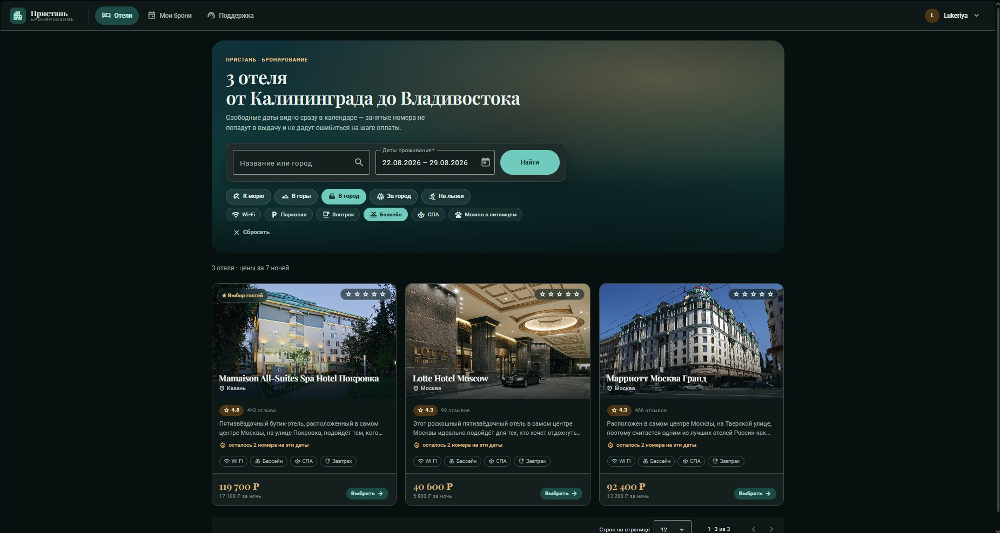

# Hotel Booking

Сервис поиска и бронирования отелей: витрина для гостя, рабочий стол менеджера
и админка. Angular + NestJS + MongoDB, обмен данными через GraphQL.

Новые фичи приложения [тут](https://github.com/users/stanis1avs/projects/3)

[Функциональность, запуск, команды и эксплуатация](FUNCTIONAL.md)

### Основная функциональность:
- Поиск отелей по названию, городу и датам — занятые на период отели в выдачу не попадают
- Фильтры по направлению (море, горы, город) и по удобствам (бассейн, СПА, завтрак)
- Указание остатка: «остался 1 номер на эти даты»
- Бронирование в три шага: даты → выбор номера → подтверждение со сводкой и итогом
- Галерея фотографий номера
- Управление своими бронями
- Служба поддержки с перепиской и отметкой непрочитанных
- Дашборд менеджера: выручка, брони, заезды — с динамикой к прошлому месяцу и спарклайнами
- Управление отелями, номерами и пользователями через админку
- Система ролей: **клиент / менеджер / администратор**
- Тёмная тема по системной настройке

## Архитектура ролей

| Роль | Доступ |
|------|--------|
| **client** | Поиск, бронирование, свои брони, поддержка |
| **manager** | Дашборд, все брони с отменой, очередь обращений |
| **admin** | Отели, номера и пользователи: создание, правка, удаление |

---

## Технический стек

### Backend
1. **NestJS** — основной фреймворк
2. **MongoDB** + **Mongoose** — база данных
3. **Apollo Server** + **@nestjs/graphql** — GraphQL-схема по code-first
4. **JWT + Passport.js** — аутентификация: access в памяти клиента,
   refresh в httpOnly-cookie, со своим секретом, `jti` и отзывом на сервере
5. **class-validator** + **class-transformer** — валидация DTO и аргументов GraphQL
6. **@nestjs/throttler** — ограничение частоты запросов на входе и регистрации
7. **graphql-depth-limit** + **graphql-query-complexity** — потолок глубины и стоимости запроса
8. **helmet** — заголовки безопасности
9. **bcrypt** — хеширование паролей
10. **Socket.IO** — шлюз чата поддержки
11. **Jest** — юнит-тесты провайдеров

### В разработке
- _**ЮKassa**_ — оплата брони: депозит, правила отмены, возврат
- _**Temporal**_ — сага бронирования и оплаты, письма и отложенные напоминания
- _**Hugging Face**_ — смысловой поиск отелей: эмбеддинги вместо поиска по подстроке
- _**sharp**_ — нарезка изображений в webp трёх размеров под `srcset`
- _**OpenTelemetry**_ — трассировка запросов, следом метрики
- _**Python-аддон**_ — Time-series ML, прогноз загрузки для дашборда менеджера
- _**Hyperledger Fabric**_ — общий реестр квот и комиссии с каналом продаж
- _**Redis**_ — когда экземпляров станет больше одного

### Frontend (Angular — актуальный)
1. **Angular 21** — standalone-компоненты, сигналы, новый синтаксис шаблонов
2. **NgRx** — store и effects
3. **Angular Material 3** — системные токены темы
4. **Tailwind CSS** — шкала текста завязана на токены M3
5. **RxJS**
6. **Apollo Client** — весь обмен данными, кроме загрузки файлов
7. **Vitest** — юнит-тесты редьюсеров и утилит

### В разработке
- _**Socket.IO client**_ — живая доставка сообщений поддержки
- _**Three.js**_ — панорамы номеров 360°

### Frontend (React — legacy)
> Первоначальная реализация, заменена на Angular. Лежит в [`_old_frontend/`](_old_frontend/).

1. **React** + **TypeScript**
2. **Redux Toolkit** + **Redux Saga**
3. **Tailwind CSS**
4. **Socket.IO**
